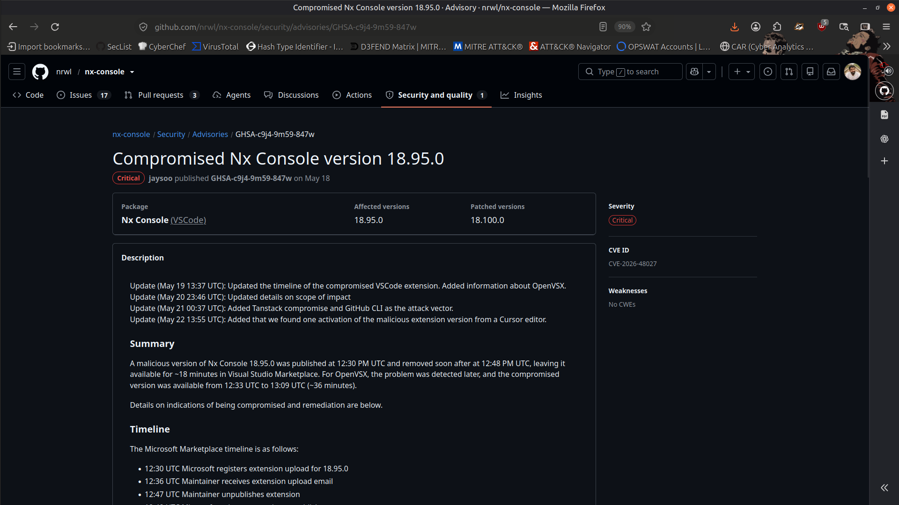
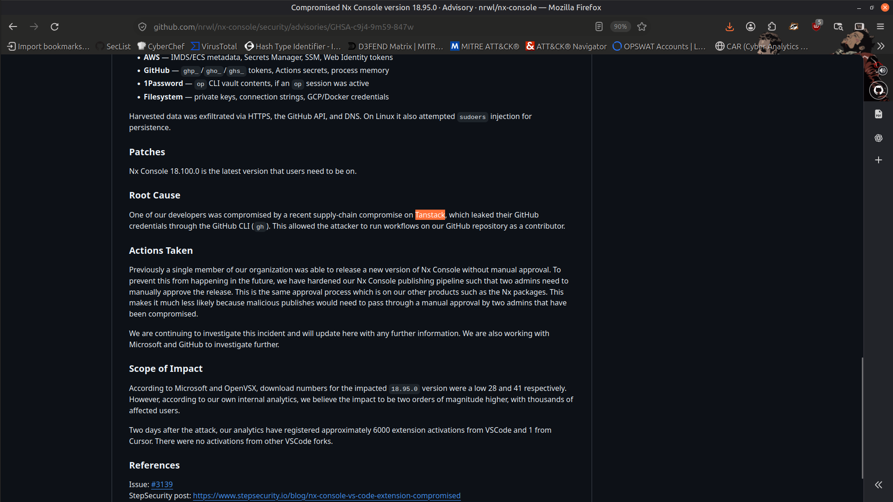
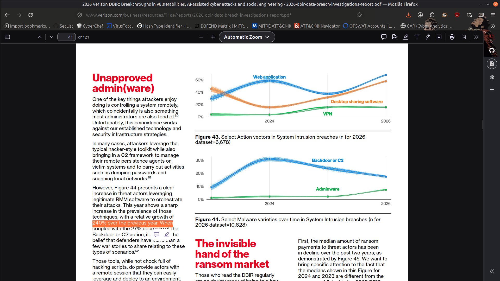
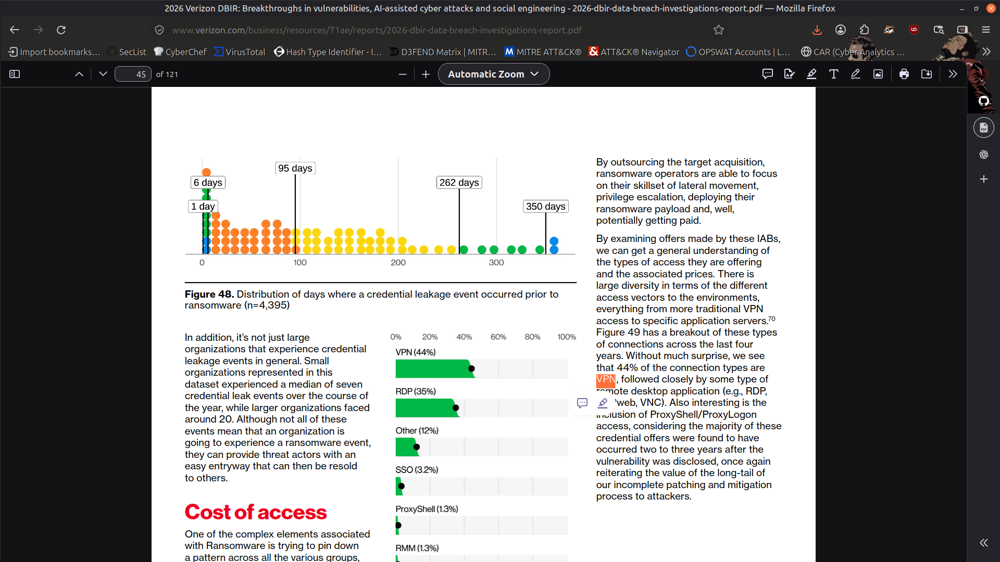
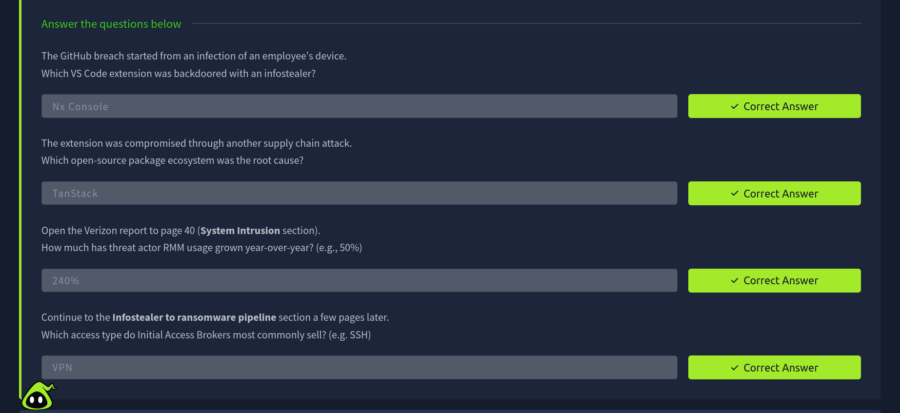

# 🛡️ Defensive Security Trends

Completed this TryHackMe room, which provided an overview of current defensive security trends and the evolving cybersecurity threat landscape from a SOC perspective.

## 🎯 What I Learned

- ⚡ **Time-to-Impact** – Understanding how quickly attackers can execute attacks and impact organizations.
- 🔐 **Valid Account Abuse** – Learning how adversaries exploit legitimate credentials to gain unauthorized access.
- 📦 **Supply Chain Attacks** – Understanding supply-chain threats and their impact on organizations from a SOC perspective.
- 🤖 **AI in Cybersecurity** – Exploring how AI is influencing both offensive and defensive security.
- 🕵️ **Attacker Tooling** – Understanding the tools and techniques used by modern threat actors.
- 📊 **Threat Intelligence & Trends** – Reviewing security reports and real-world examples to understand the evolving threat landscape.

## 🧠 Key Takeaway

This room helped me understand how modern cyber threats are evolving and why SOC teams need to adapt their detection, investigation, and response strategies to keep up with increasingly sophisticated attacks.

## 📸 Screenshots

### Github Compromise 

Backdoored VS Code Extension with Infostealer

---

Open-Source Package Ecosystem Behind the Compromise

---

### Verizon Compromise 

Year-over-Year Growth in Threat Actors' RMM Usage

---

Most Commonly Sold Initial Access Type by Initial Access Brokers

---

### Result

