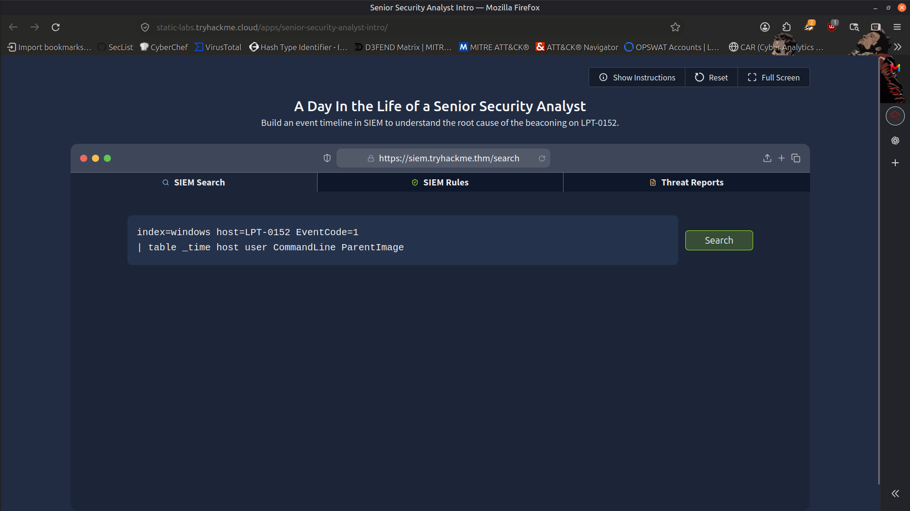
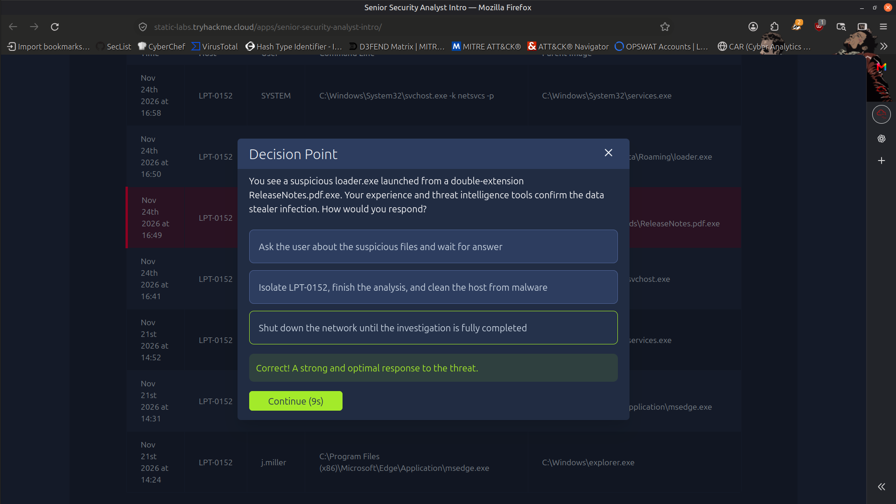
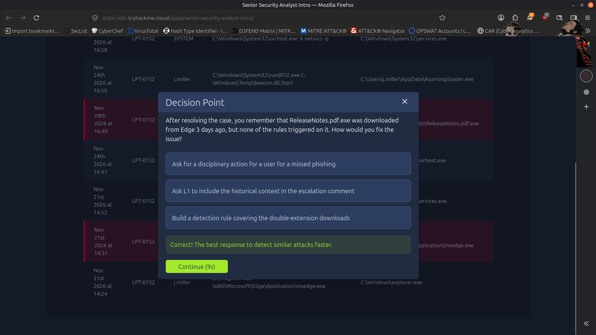
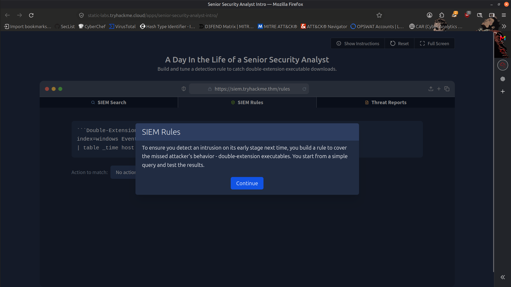
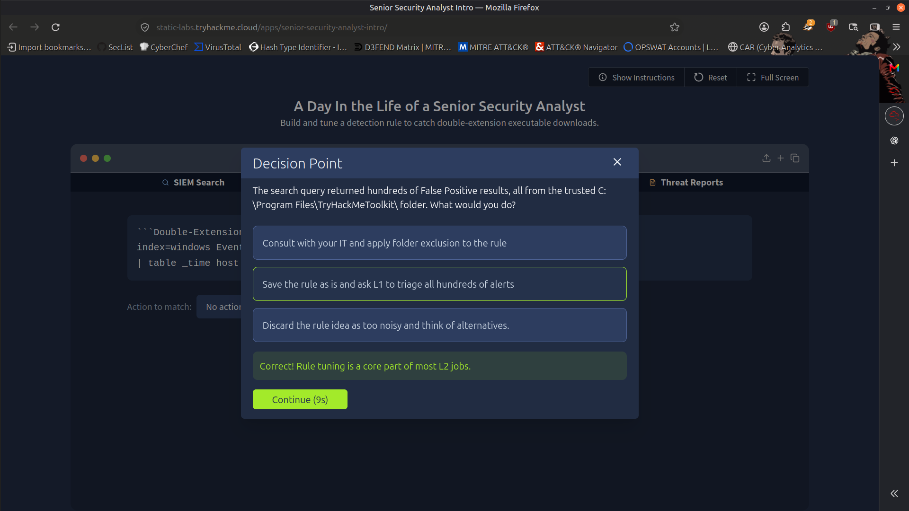
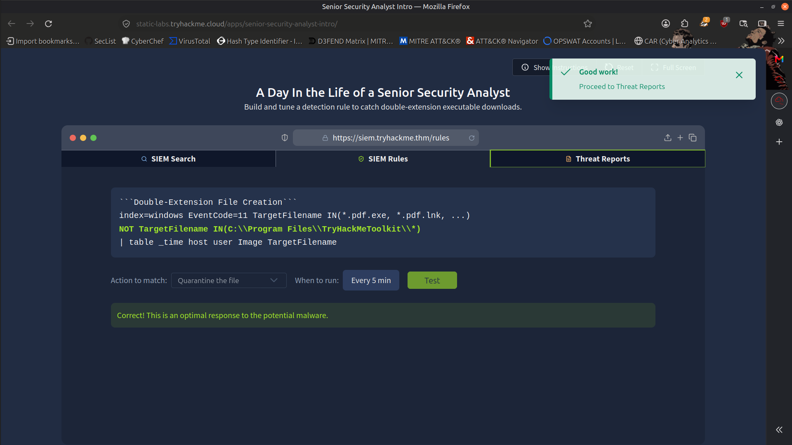
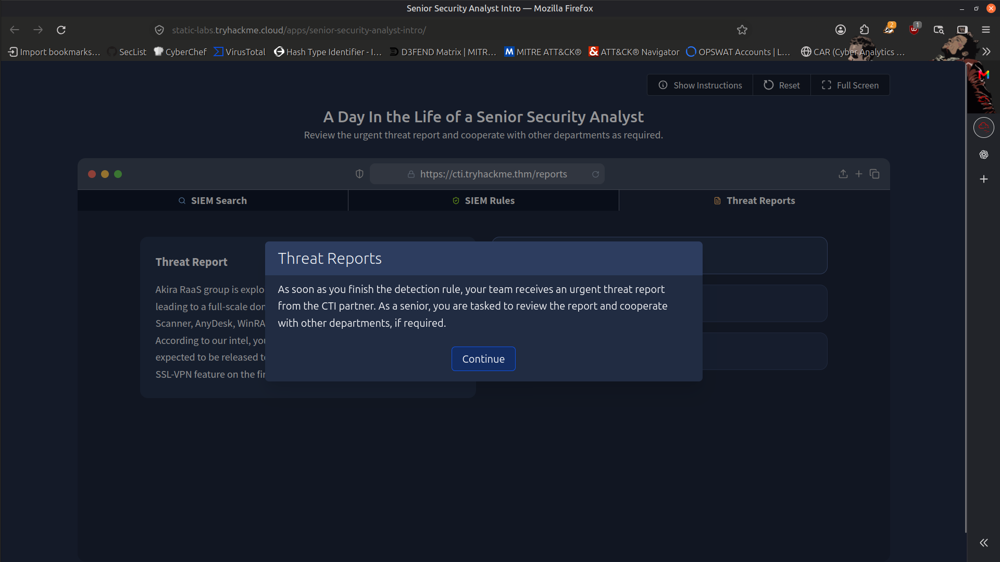
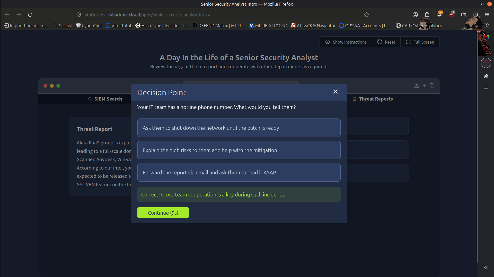
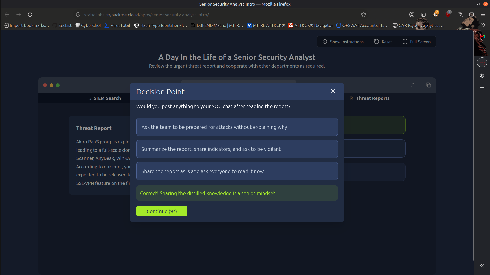

# 🎯 In the Shoes of a SOC Level 2 Analyst

Completed the **Senior Security Analyst Intro** room on TryHackMe. This room introduced me to the responsibilities of middle-to-senior security analysts and how their roles differ from junior SOC analysts.

---

## 📚 What I Learned

- 🔍 Understood the differences between junior and senior security analyst responsibilities.
- 📈 Explored the skills required to prepare for a promotion.
- 🖥️ Learned about a typical SOC Level 2 analyst's daily routine.
- 🚨 Explored practical scenarios involving alert triage, detection-rule work, and urgent incident response.

---

## 🛠️ Hands-on Experience

Worked through the guided in-browser training application and followed its scenarios to understand how SOC Level 2 analysts approach security operations and investigations.

---

## 📸 Screenshots

### SIEM Search

---

### SIEM Rules

---

### Threat Report

---

## 💡 Key Takeaway

This room helped me understand how responsibilities evolve from basic alert monitoring and triage towards deeper investigations, detection improvements, and handling urgent security incidents.