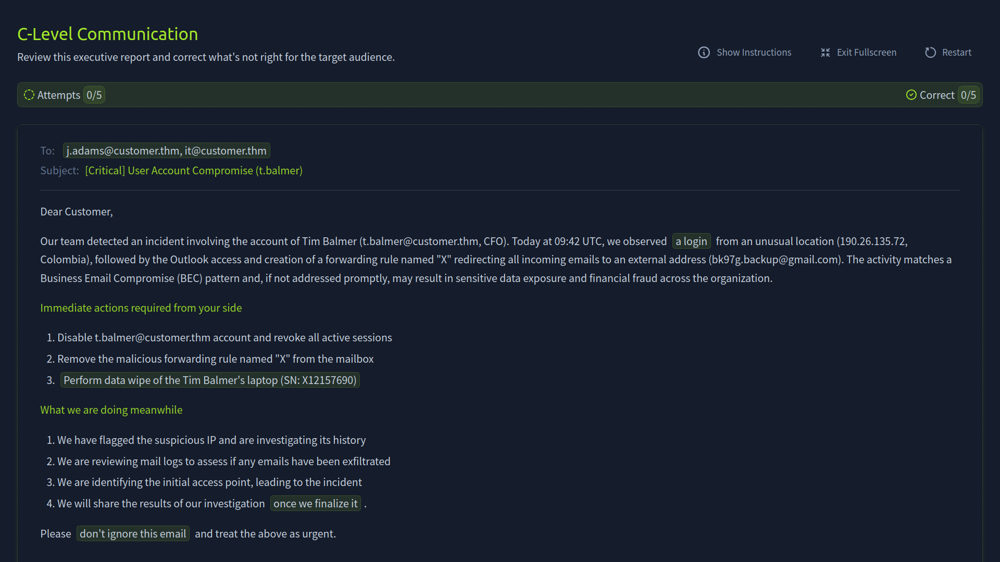
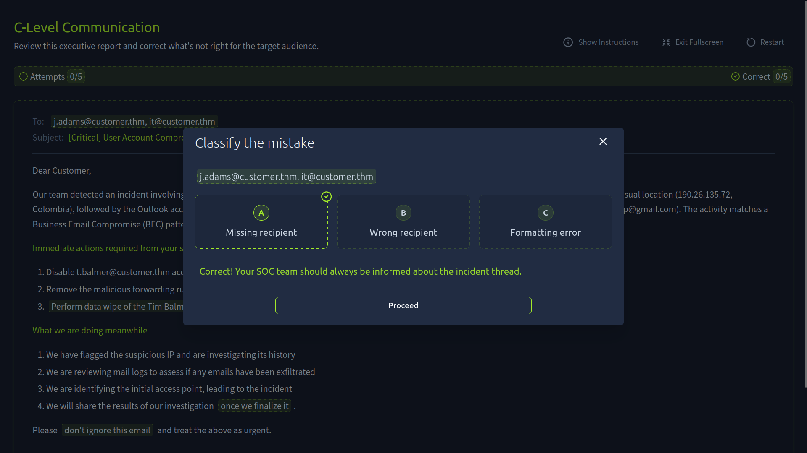
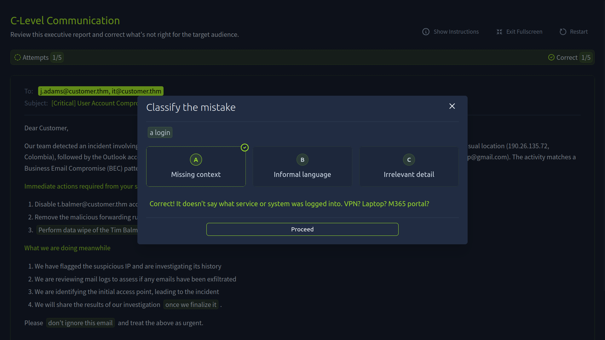
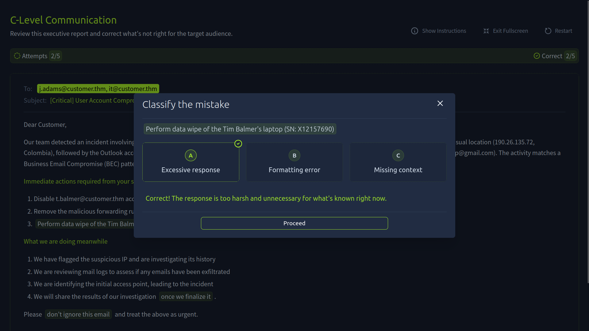
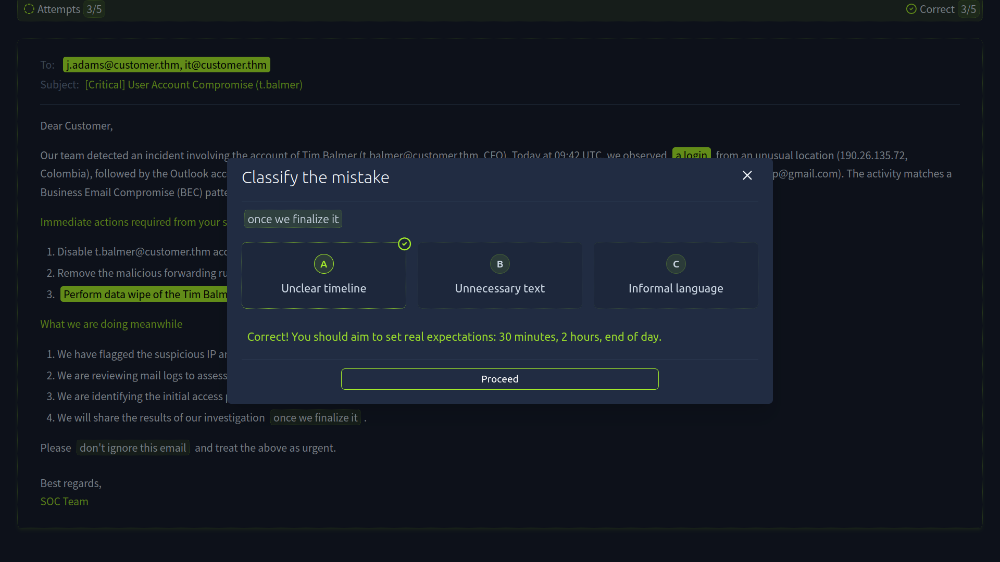
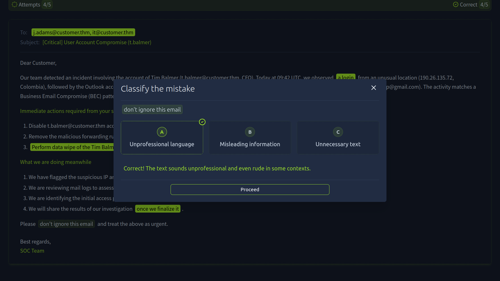
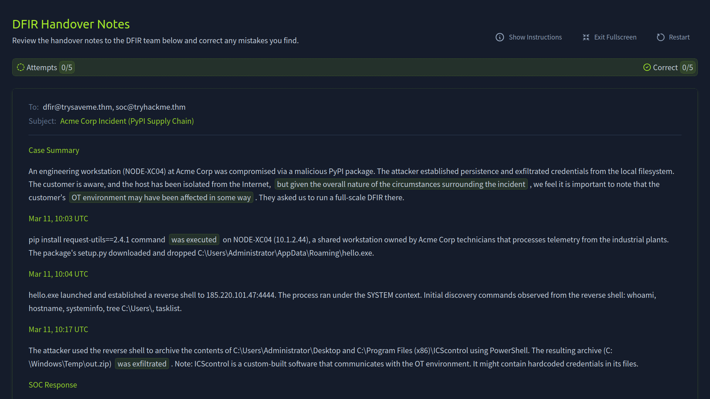

# 📝 Report Writing for SOC L2

This room focused on professional report writing in a SOC environment, covering how to communicate security findings clearly to different audiences, from executives to DFIR teams.

## 🎯 What I Learned

- 📊 **Executive Reporting** – Writing concise, business-focused reports to communicate security incidents and their potential impact.
- 🔍 **DFIR Handover** – Preparing factual and actionable incident handovers with clear timelines, scope, actions taken, and indicators of compromise.
- 🤖 **AI-Assisted Reporting** – Understanding how GenAI can assist with report writing while keeping the analyst responsible for decisions and conclusions.
- 📋 **Report Templates** – Understanding how reports should be structured based on the intended audience.
- 🛡️ **Security & Accuracy** – Avoiding confidential data exposure, unsupported conclusions, unnecessary filler, and unvalidated containment actions.

## 🧪 Practical Exercises

- Completed the Executive Report Writing simulation.
- Completed the DFIR Handover simulation.

## 📸 Screenshots

### Report For C-Level Communication

---

### Missing Receipent

---

### Missing Context

---

### Excessive Response

---

### Unclear Timeline

---

### UnProfessional Language

---

### DFIR Handover Notes

The DFIR simulation covered similar reporting improvements, focusing on clear, factual, chronological, and actionable handover notes.

---

## 💡 Key Takeaway

**AI can assist with report writing, but the SOC Analyst remains the decision-maker.**

Clear communication, evidence-based findings, and actionable recommendations are essential when handling security incidents.