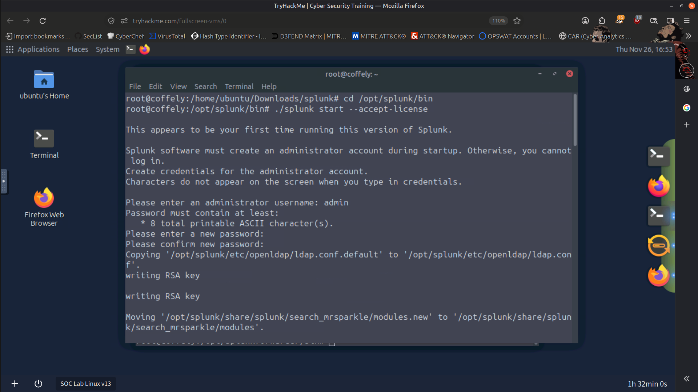
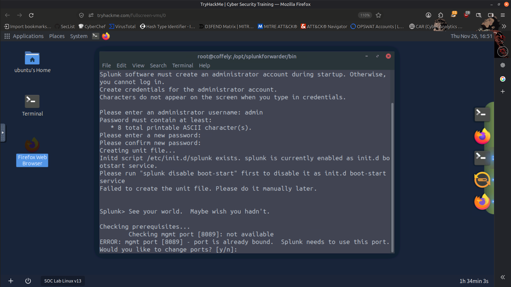
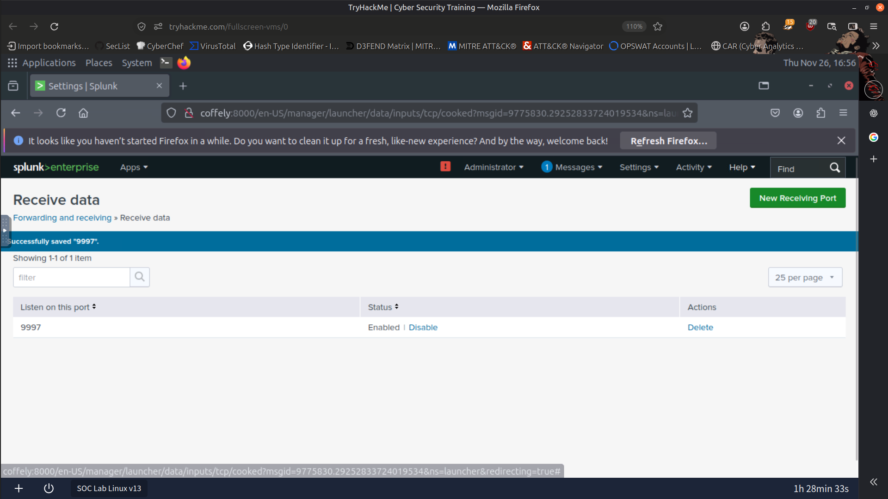
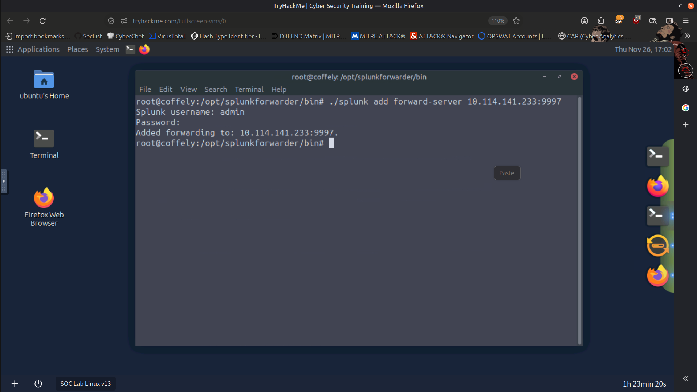
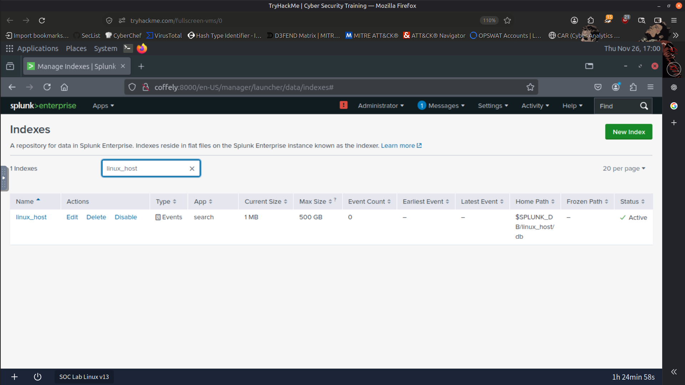
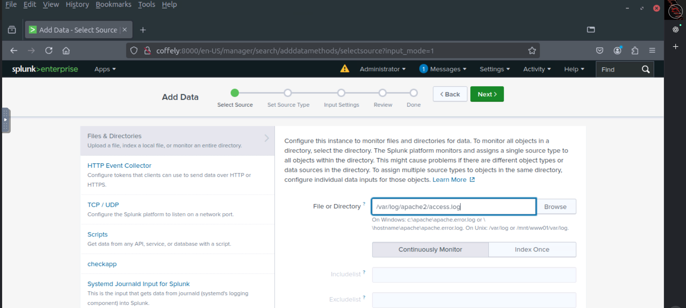
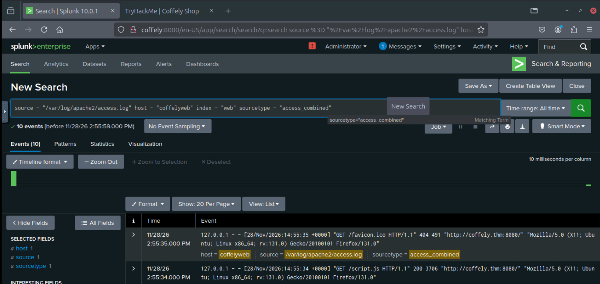
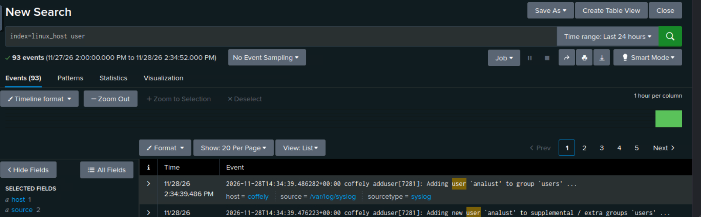

# 🛡️ Splunk Installation & Configuration on Linux

## 📌 Overview
In this room, I learned how to install and configure Splunk Enterprise and the Splunk Universal Forwarder on Linux systems. I explored managing Splunk through the command line, collecting logs from different sources, and forwarding them to a centralized Splunk instance for monitoring and analysis.

## 🎯 What I Learned

- 🖥️ **Splunk Installation** – Installing and configuring Splunk Enterprise on a Linux system.
- 📡 **Universal Forwarder** – Installing and configuring the Universal Forwarder to collect and forward logs.
- ⌨️ **CLI Management** – Managing Splunk services and configurations using Linux command-line tools.
- 📂 **Log Collection** – Configuring Splunk to collect operating-system and web server logs.
- 🔎 **Log Analysis** – Searching and reviewing collected log data through Splunk Web.
- 🌐 **Deployment Server** – Enabling Splunk as a deployment server for centralized forwarder management.

## 📸 Screenshots

### Splunk Enterprise Installation

---

### Universal Forwarder Configuration

---

### Splunk Config

---

### Forwarder Config

---

### First Index

---

### Adding Web Logs

---

### Web Logs

---

### User Creation

---

## 💡 Key Takeaway
This room helped me understand how Splunk collects, forwards, and centralizes logs from Linux systems. It gave me practical experience with SIEM deployment and log management, building a foundation for further Splunk-based monitoring, detection, and investigation.

